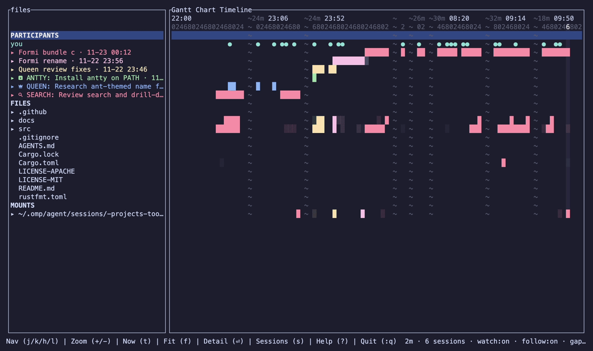
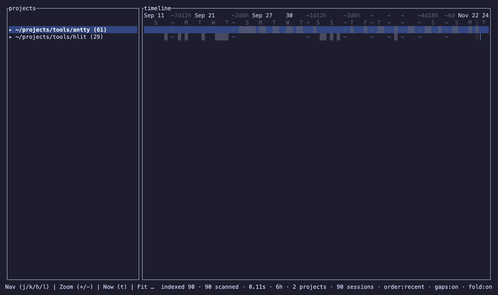

# antty

A terminal Gantt timeline of coding-agent sessions and the files they touched,
plus `formi`, an overview of every project with agent sessions.



- Live session and subagent lanes
- Per-file activity rows, merged across Git worktrees
- Filesystem-watcher attribution of changes to tool calls, with diffs
- Tool-call stats and an action filter (edits, evals, web, MCP, …)

## formi

Every project with agent sessions on one timeline; Enter opens it in antty.



- Projects newest first, older sessions and projects folded
- Stats panel and a dashboard ranking projects by tool calls
- Activity indexed in the background, cached, and updated live

## Quick start

```
cargo install --locked --git https://github.com/filipkristofiak/antty --tag v0.2.27
```

Then run `antty` from inside a project directory, or `formi` anywhere for an overview of every project.

## Harness support

Reads oh-my-pi (omp), Claude Code and Codex CLI session logs, shown together.

## Docs

- [Installation](docs/installation.md)
- [Usage](docs/usage.md)
- [formi](docs/formi.md)
- [How it works](docs/how-it-works.md)
- [Architecture](docs/architecture.md)
- [Roadmap](docs/roadmap.md)

## License

Licensed under either of [Apache License, Version 2.0](LICENSE-APACHE) or
[MIT license](LICENSE-MIT) at your option.

